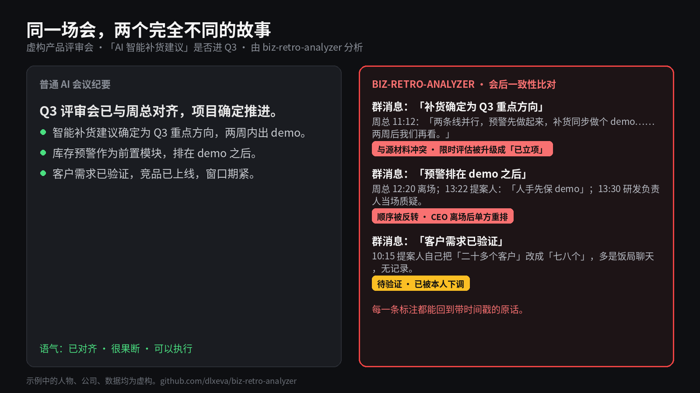

<p align="right">
  <a href="./README.md">English</a> | <a href="./README.zh-CN.md"><strong>简体中文</strong></a>
</p>

# 会后照妖镜
### `biz-retro-analyzer` —— 开源 Agent Skill，专做会后审计

> **纪要告诉你大家说了什么，它告诉你哪句话其实没人证明过。**

**[Live demo report](https://dlxeva.github.io/biz-retro-analyzer/demo/)**

> 「拿评审会去跑，会后的 HTML 直接把我吓着。」
> —— dlxeva，作者



## 一场虚构的评审会

一家做门店收银和库存软件的公司开 Q3 产品评审会，议题只有一个：「AI 智能补货建议」要不要进 Q3。

- **高远**（产品副总裁）是提案人，开场就说「这个必须做」，理由是聊过二十多个客户、竞品已经上线。
- **马骏**（研发负责人）追问六个人月是谁估的，坦言组里没正式评估过。
- **苏晴**（数据分析师）拿出数据：1200 多家活跃门店里，只有 7% 有可用的库存数据；上半年流失的 41 家客户里，明确去了竞品的只有 3 家。
- **周总**（CEO）后半段才进来，听完定了「两条线并行，两周后再看」，然后先走了。
- 会后 20 分钟，高远在项目群里发了一条「会议结论」。

拿同一份逐字稿加那条群消息，分别交给普通 AI 和 biz-retro-analyzer：

| 普通 AI 纪要怎么写 | biz-retro-analyzer 怎么看 |
|---|---|
| 「Q3 评审会已与周总对齐，补货确定为 Q3 重点方向。」 | **与源材料冲突。** 周总的原话是「两条线并行，预警先做起来，补货同步做个 demo……两周后我们再看」。这是一个两周的限时评估，到了群消息里成了「已立项」。 |
| 「库存预警排在 demo 之后。」 | **决策者离场后被反转。** 周总一走，高远就宣布「人手先保 demo」，马骏当场提出质疑。周总定的是「预警先做」。 |
| 「客户需求已验证。」 | **待验证。** 高远自己在会上就把「二十多个客户」改口成「七八个」，而且大多是饭局上聊的，没有记录。 |

普通纪要读起来是一场顺利对齐的会；它看到的是，会后那条群消息悄悄改写了老板的决定。

*人物、公司、数据全部虚构。[完整逐字稿](./examples/product-review-fictional/transcript.txt) · [完整 HTML 报告](https://dlxeva.github.io/biz-retro-analyzer/demo/)*

## 它做三件事
- **给每条主张记账。** 每个结论标上证据状态（已确认 / 待验证 / 假设 / 与源材料冲突）和时间戳锚点，对不上的标红。
- **查会后发生了什么。** 拿会后的群消息、「对齐」纪要和会上原话逐条比对，抓出悄悄的改写。
- **反向审计。** 把结论反过来推一遍，看同样的证据是否也说得通——包括反审你自己的叙事，最后输出可转发的 HTML 报告。

## 30 秒上手

按 Agent Skill 安装——Claude Code、Cursor、Codex 的目录布局见 [`INSTALL.md`](./INSTALL.md)。然后贴入逐字稿（以及会后消息），说：「审计这场会，给我 HTML 报告。」

可选 CLI（`scripts/retro_tool.py`，Python 3.8+，无第三方依赖）：

```bash
python3 scripts/retro_tool.py preprocess meeting.txt -o meeting_annotated.txt
python3 scripts/retro_tool.py scaffold --mode B --format json -o report.json
python3 scripts/retro_tool.py validate report.json
python3 scripts/retro_tool.py validate analysis.md -t meeting.txt
python3 scripts/retro_tool.py render report.json -o report.html
```

## 坦白说它的局限
- **表演性会议**（真正的决定在会外做的）它分析不好，见 [`references/honest-limits.md`](./references/honest-limits.md)。
- **输入决定上限：** 需要发言人标签基本可靠的逐字稿。
- **评测还很初步。** 目前结果来自少量合成案例、单一评分人，且评分量规部分奖励的正是被测功能本身。只能当冒烟测试，不能当证明。
- **它标记事实，不审判人。** 「与源材料冲突」只说明记录对不上，不说明动机；报告会把无心和有意的解释并列。

---

## 快速开始

当你手里有混乱的原始材料，并且需要的不是通用摘要，而是带证据纪律的复盘时，可以直接使用下面这段提示词：

```md
Use biz-retro-analyzer / Mode C: Audit Pack.

Input stack:
- Source evidence: [粘贴逐字稿、会议纪要、现场观察或其他原始材料]
- Context: [简要说明项目背景和当前疑问]
- Later reasoning: [可选；把后续分析、假设或复盘对话单独粘贴]

Please produce:
1. Structured Fact Record
2. Project Thread
3. Advancement / Influence Chain
4. Participant Understanding Map
5. Judgment and Reverse Audit
6. Current Actions

Rules:
- Separate facts, participant claims, and model inferences.
- Tag high-impact judgments with Status, Strength, Basis, and Source anchor.
- Treat suspicious or contradictory actions as diagnostic signals, not automatic proof of bad faith.
- Do not treat later reasoning as source evidence.
```

更轻量的事实整理，用 `Mode A: Fact Pack`。  
完整复盘，用 `Mode B: Retro Pack`。  
对已有判断做强审计，用 `Mode C: Audit Pack`。

### CLI（可选）

`scripts/retro_tool.py`（Python 3.8+，无第三方依赖）是检查器和渲染器，不能代替分析，也不能做说话人分离。

```bash
python3 scripts/retro_tool.py preprocess meeting.txt -o meeting_annotated.txt
python3 scripts/retro_tool.py scaffold --mode B --format json -o report.json
python3 scripts/retro_tool.py validate report.json
python3 scripts/retro_tool.py validate analysis.md -t meeting.txt
python3 scripts/retro_tool.py render report.json -o report.html
```

- `preprocess` 按发言人切轮次，并**提示**可能的噪声行，不会删行。
- `validate` 检查协议形式，以及引用的时间戳、发言人、原话是否出现在逐字稿里。PASS 不表示判断正确。
- `render` 把报告 JSON（`references/output-schema.json`）渲染成单文件 HTML 或 Markdown。

安装见 [`INSTALL.md`](./INSTALL.md)。示例：[`examples/quickstart.md`](./examples/quickstart.md)、[`examples/quickstart.report.json`](./examples/quickstart.report.json)，以及虚构 Mode C 演示 [`examples/product-review-fictional/`](./examples/product-review-fictional/)。

项目状态：

- 开源协议：MIT，见 `LICENSE`。
- 后续计划：见 `ROADMAP.md`。
- 评估：[`EVALUATION.md`](./EVALUATION.md)。协议用例在 `tests/cases/`（只把 `input.md` 交给模型）。消融报告见 [`evaluations/ablation-2026-07/`](./evaluations/ablation-2026-07/)。引用分数前请先读该目录 2026-10-12 勘误——原表没有重跑；按协议「&lt;50 = 反向倾向」，校准集是 66/67，不是 67/67。
- 合成对抗评估案例：见 `evaluations/adversarial-dialogue-werewolf/`。

---

## 这是什么

这**不是**转录工具，也**不是**通用会议纪要模板。

它是一个**证据优先（evidence-first）的复杂对话情报分析 skill**，用于把原始对话材料变成可复用的分析资产，覆盖参与方理解层级、项目推进结构、影响链、判断风险和下一步行动。

以下情况尤其适合使用：

- 多场会议并存
- 多种材料混在一起
- 事实与判断混杂
- 多方角色关系复杂
- 试点场景和方向持续变化
- 多方协同、谈判或推进摩擦明显

---

## The Werewolf Test / 狼人杀测试

仓库中包含一个合成评估案例：**The Werewolf Test**。

狼人杀在这里不是游戏功能，而是复杂对话分析的最小试验场。它把真实项目对话里常见的风险压缩到一个小型样本中：

- 公开发言不等于事实
- 说得自信的人可能是错的
- 表达弱的人可能是对的
- 权力和背书可以被传递
- 可疑行为可能只是误判，不一定是恶意
- 最终结果取决于谁把某个叙事推进成了行动

重点不是“盘出狼人”，而是测试 skill 能否在隐藏动机下保持证据纪律。

见：`evaluations/adversarial-dialogue-werewolf/`

---

## 最适合的场景

适合用于：

- 会后复盘
- 合作推进回顾
- 项目演进分析
- 复杂项目推进结构分析
- 多方协作型复盘
- 现场观察与会议材料联合分析
- “到底发生了什么、什么变了、下一步该怎么办”这类问题

例如：

- 分析一次重要工作会后的多场逐字稿
- 把录音、纪要和现场观察整理成一条清晰脉络
- 审计当前叙事是否真的有证据支撑
- 识别谁提出了框架、谁继承了它、谁改变了下一步路径
- 区分试点场景和系统/产品本体

---

## 不适合的场景

以下场景**不建议**作为主工具使用：

- 普通会议纪要
- 简单 action items 提取
- 情绪分析
- 通用销售电话评分
- 纯转录
- 纯语气风格评估

如果你只需要“摘要 + 下一步动作”，这个 skill 可能过重。

---

## 诚实的边界

这个 skill 并不适合所有顺滑会议。

有些会议是**表演性的**：真正决定已经在会议前、在更小的房间里完成，会议只是为了让决定被看见。在这种情况下，顺滑不是需要调查的信号，顺滑就是产品本身。

因为这个 skill 天然会对抗过于顺滑的叙事，所以它在表演性、仪式性或关系维护型会议中可能产出假阳性。

完整边界说明见：`references/honest-limits.md`。

---

## 核心设计

这个 skill 依赖六条原则：

1. **证据优先**  
   先保留原始材料，再做解释。

2. **事实先于判断**  
   先有结构化事实层，再有结论和判断层。

3. **声称不等于事实**  
   参与方说了什么、暗示了什么、相信什么，都要和材料真正能确认的事实分开。

4. **理解层级很重要**  
   不只看“他想要什么”，还看“他真正懂什么、懂到哪一层”。

5. **影响链很重要**  
   识别一个框架、说法、背书或下一步路径是如何在参与方之间传递，并最终变成行动的。

6. **必要时强制反向审计**  
   如果叙事过于顺滑或自信，就反过来压力测试这些结论。

---

## 输入模型

这个 skill 支持分层输入。

### 第一层：原始证据

至少提供以下之一：

- 逐字稿
- 会议纪要
- 现场观察记录
- 视频分析文本

如果用户直接给的是音频，应该先转成可用逐字稿，再进入后续分析。

还应尽量识别互动上下文。可用标签包括：

- `formal_meeting`
- `working_session`
- `informal_debrief`
- `private_side_conversation`
- `asymmetric-awareness conversation`

这些上下文很重要，因为非正式或非对称知情材料往往更接近真实顾虑，但也更不稳定。它们适合用于识别顾虑、约束、推进阻力和协同风险，不应在缺少跨材料支持时直接上升为稳定意图、正式立场或承诺。

### 第二层：上下文补充（可选）

- 项目/事项背景
- 当前合作关系
- 用户自己的疑问
- 初步设想或假说

### 第三层：后续分析对话（可选）

- 用户与 AI 的分析对话
- 后续复盘讨论
- 中间结论
- 纠偏和修正过程

注意：后续分析对话只能作为**判断层补料**，不能当成原始事实。

### 非对称知情材料的伦理边界

这个 skill 可以分析非正式或非对称知情条件下的项目材料，但仅限于项目相关的：

- 理解分析
- 协同分析
- 风险分析
- 激励与约束分析
- 决策条件分析

不应用于产出：

- 人格画像
- 超出项目范围的个人利用策略
- 基于他人在非对称知情条件下表达而形成的操控性建议

这类材料导出的判断应保持收窄、内部使用、待验证的默认姿态。

### 团队动力学分析 vs 人格画像

分析团队如何协作是**允许且往往是必要的**——包括沟通风格错位、决策权不对等、信任缺口、假共识、协同摩擦等。

边界在于：**分析人们如何一起工作（允许）vs 分析人们是什么样的人（不允许）。**

团队动力学观察应锚定在可观察的行为和项目结果上，而不是固定的人格特质。

---

## 输出模型

根据输入深度和需求，skill 会输出以下一种或多种结果：

1. **结构化事实底稿**
2. **复盘脉络 / 项目线程**
3. **推进链 / 影响链**
4. **参与方理解地图**
5. **关键判断与反向审计**
6. **当前动作建议**
7. **方法论沉淀**

目标是清晰区分：

- 哪些是已确认事实
- 哪些是参与方声称
- 哪些是推断
- 哪些证据还缺
- 下一步该做什么

### HTML 输出模式

这个 skill 现在也支持 `HTML` 报告输出模式，适合以下情况：

- 需要生成可直接分享的单页报告
- 需要比 Markdown 更强的视觉分层
- 需要把证据层、项目脉络、反向审计和动作建议放进同一页面

先把分析写成报告 JSON（`references/output-schema.json`），再渲染：

```bash
python3 scripts/retro_tool.py render report.json -o report.html
```

HTML 是 Mode A / B / C 的呈现方式，不是第四种深度。没有 Python 时，可以手填 `assets/html-report-template.html`。详见 `references/html-output-mode.md`。

用户不需要一开始就知道这个模式存在。  
当分析结果已经具备完整结构时，skill 可以在输出阶段主动提示：“这份内容已经适合升级为 HTML 报告页”。

### 证据标注

这个 skill 支持一套轻量的证据标注约定，用来标识重要判断的证据状态：

- `Status`：`Confirmed` / `Inferred` / `Assumption` / `Needs validation`
- `Strength`：`High` / `Medium` / `Low`
- `Basis`：`Source quote/paraphrase` / `Cross-source pattern` / `User context` / `Later reasoning only`
- `Source anchor`：对高影响判断补充简短来源锚点，如会议、材料、说话人或片段

它尤其适合标注以下内容：

- 角色诉求判断
- 项目边界判断
- 价格、筹码或杠杆判断
- 会影响承诺的下一步行动
- 谁控制了决策路径的判断
- 对可疑或矛盾行为的解释
